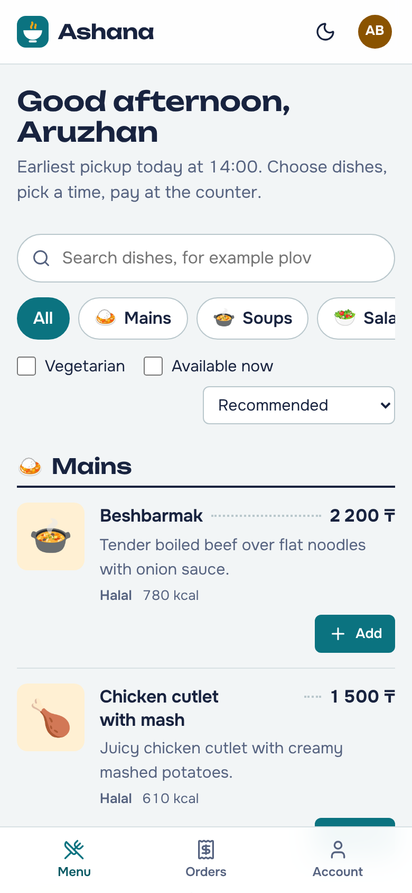
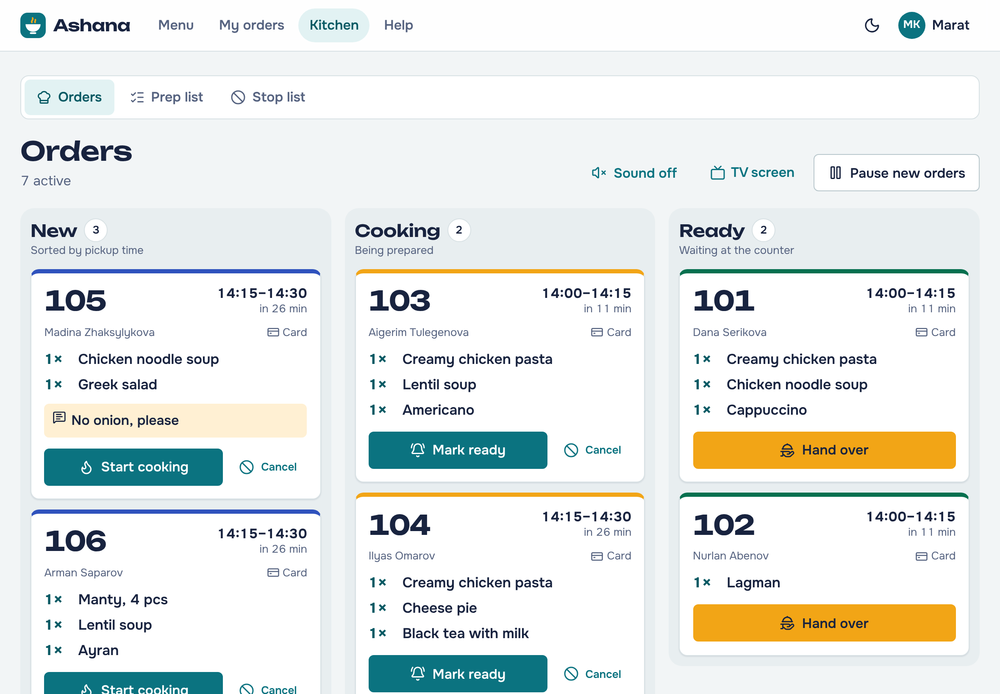
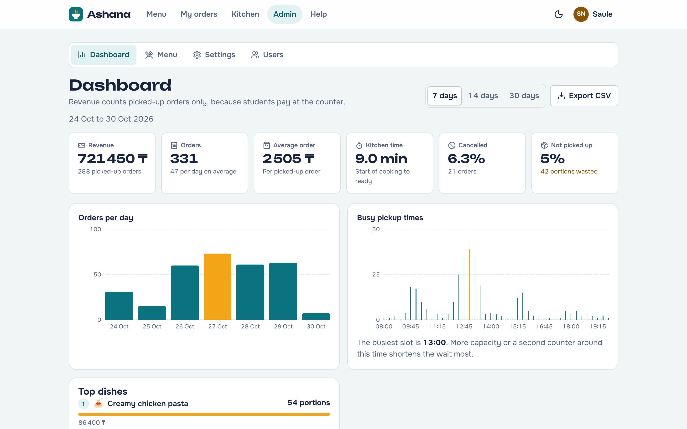
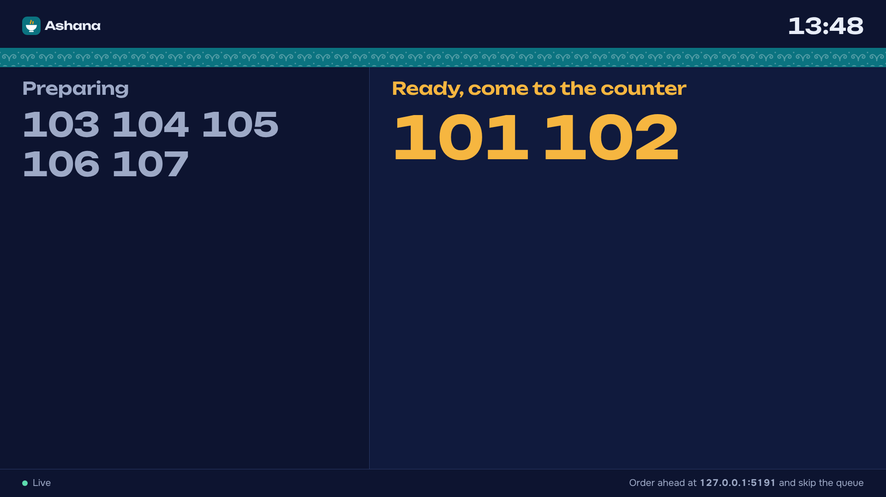

# Ashana FP — canteen pre-orders, built the functional way

Ashana lets students order canteen food ahead of time and pick it up at a chosen time, without standing in the queue.
The kitchen sees new orders the moment they are placed, the TV at the counter shows which numbers are ready,
and the administrator manages the menu and sees how the canteen is doing.

*Ashana* (асхана) means "canteen" in Kazakh.

Final project for **Introduction to Functional Programming (C# / .NET, Blazor)**, group **IT-2509**:
**Abay Zharkyn** and **Amna Bangash**.

## Functional programming in this project

Ashana FP is a **functional core inside an imperative shell**:

* **Immutable data.** Every entity is a record with `private init` setters. The whole canteen is one immutable
  `CanteenState` value made of immutable collections. "Changing" anything returns a new value.
* **Pure use cases.** Placing an order is a pure function `CanteenState → Result<Change<Placement>>`
  written as one LINQ query over `Result`. Time comes in as an argument; nothing is saved or logged inside.
* **Errors as values.** `Result<T>` (Either) and `Option<T>` (Maybe) from our own small library,
  [`Ashana.Functional`](src/Ashana.Functional), with `Map`, `Bind`, `Ensure`, `Traverse` and LINQ support.
  Their functor and monad laws are unit-tested.
* **Unions and pattern matching.** `LoginOutcome`, `AppEvent` and `Trampoline<T>` are closed record hierarchies
  handled with `switch` expressions.
* **Higher-order functions.** Composition (`Then`, `Compose`), currying and partial application (`Curry`, `Apply`),
  memoization (`MemoizeLast` caches the menu per state snapshot), lazy sequences (`Seq.Unfold` builds the pickup slots),
  stack-safe recursion (`Trampoline` finds the next free slot).
* **One isolated mutation.** The state store keeps the current state in one reference. Readers never lock; writers
  apply pure transitions one at a time, so stock can never be oversold and a failed operation changes nothing.

How every topic and assignment of the course maps to the code: [docs/functional-programming.md](docs/functional-programming.md).

| Student (phone) | Kitchen board (tablet) | Admin dashboard | TV at the counter |
|---|---|---|---|
|  |  |  |  |

## The problem

Everybody gets hungry at the same break. At 12:00 hundreds of students reach the canteen at once: the queue
eats most of the break, popular dishes run out in front of people who waited, and the kitchen cannot plan.
Delivery apps (Glovo, Wolt, Yandex Eda) bring food from restaurants to your door, but they do not help
inside a university canteen.

Ashana spreads the rush out:

* **Pickup slots with a capacity.** Opening hours are cut into 15-minute slots; each slot takes a limited number
  of orders and shows how full it is, so students choose 12:15 instead of all coming at 12:00.
* **Portions are reserved when you order.** Nobody pays for a dish that sold out while they were waiting.
* **The kitchen sees exactly what to cook for each slot**, and the student sees the status change live:
  placed → cooking → ready → picked up.

## Features

**Students**
* Menu with search, categories, "vegetarian" and "available now" filters, sorting, live stock ("3 left", "Sold out").
* Cart that survives a page reload (stored encrypted in the browser).
* Checkout with a pickup-time picker that shows how busy each slot is; payment at the counter (card, cash or QR).
* Live order page with a big pickup number, progress steps, a sound, a vibration and an optional browser
  notification when the food is ready. Cancel until cooking starts.
* Order history with "Order again".

**Kitchen**
* Live board with three columns (New, Cooking, Ready), late orders highlighted, one big button for the next step,
  a chime for every new order, cancellation with a reason.
* Prep list: how many portions of each dish to cook for each pickup slot.
* Stop list: hide a dish or add portions in one tap.
* "Pause new orders" when the kitchen is overwhelmed; every open menu shows the pause message at once.

**Administrators**
* Dashboard: revenue, orders, average order, kitchen time, cancellation and no-show rates, orders per day,
  busiest pickup times, top dishes, CSV export for Excel.
* Menu editor with a live preview, conflict detection when two admins edit the same dish, categories, archive.
* Canteen settings (hours, slot length, capacity, lead time, limits) with a preview of the resulting slots.
* Users: change roles, block and unblock accounts.

**Everyone**
* Pickup TV screen (`/board`): numbers only, never names; updates live and reconnects by itself.
* Works on phones, tablets and desktops; light and dark theme; installable as an app (PWA) with an offline page.
* Accessible: keyboard navigation, screen-reader labels, WCAG AA contrast (checked automatically by the tests).

## Quick start

You need the [.NET 10 SDK](https://dotnet.microsoft.com/download/dotnet/10.0) (Windows, macOS including Apple
silicon, or Linux). No database server is needed.

```bash
cd AshanaFP
dotnet run --project src/Ashana.Web
```

Open <http://localhost:5191>. The first start creates demo data: a menu of 29 dishes, two weeks of order history
and a few active orders, so every screen has something to show.

| Role | Email | Password |
|---|---|---|
| Student | `student@ashana.test` | `Ashana2026` |
| Second student | `student2@ashana.test` | `Ashana2026` |
| Cook | `cook@ashana.test` | `Ashana2026` |
| Administrator | `admin@ashana.test` | `Ashana2026` |

The sign-in page also has one-click demo buttons. To see real time in action, open the student menu, the kitchen
board and `/board` in three windows side by side.

Useful options (they go after `--`):

```bash
dotnet run --project src/Ashana.Web -- --Seed:ResetOnStart=true      # start again from fresh demo data
dotnet run --project src/Ashana.Web -- --Storage:Provider=Memory     # keep nothing on disk
dotnet run --project src/Ashana.Web --launch-profile https            # https://localhost:7231
```

Data is saved to `src/Ashana.Web/App_Data/ashana-data.json`. All settings are in
[`appsettings.json`](src/Ashana.Web/appsettings.json) and described in the [developer guide](docs/development.md).

## Tests

```bash
dotnet test                       # unit, component and integration tests
```

```bash
cd tests/e2e                      # end-to-end tests in a real browser
npm install
npx playwright install chromium
npm test
```

| Suite | What it covers | Test cases |
|---|---|---|
| Unit (`tests/Ashana.UnitTests`) | Functor/monad laws, pure workflows, domain rules, use cases, state store, event bus | 324 |
| Component (`tests/Ashana.ComponentTests`) | Blazor components rendered in memory, clicks included | 67 |
| Integration (`tests/Ashana.IntegrationTests`) | The real app over HTTP and WebSockets: sign-in, roles, API, SignalR, security headers | 41 |
| End-to-end (`tests/e2e`) | Real browser on desktop and phone: flows, layout, accessibility audit, offline mode | 48 |

Details, the bugs the tests caught and the manual QA checklist are in [docs/testing.md](docs/testing.md).

## How it is built

* **Blazor Web App on .NET 10**: server-side rendering for a fast first paint, then Interactive Server for live pages.
* **Clean Architecture, functional core**: `Functional` (prelude) → `Domain` (immutable records, pure rules) →
  `Application` (pure workflows + thin services) → `Infrastructure` (state store, file, security, background jobs)
  and `UI` (reusable component library) → `Web` (pages, API, SignalR hub).
* **Real time** through an in-process event bus: Blazor pages update over their own connection, and a public
  SignalR hub feeds the TV screen.
* **Security**: cookie authentication, PBKDF2 password hashing with lockout, role-based authorization, antiforgery,
  rate limiting and a strict Content-Security-Policy.

```
src/
  Ashana.Functional/      Result, Option, Unit, Rule, F (pipe, compose, curry, memoize), Trampoline, Seq
  Ashana.Domain/          Orders, menu, slots, users: immutable records and pure rules
  Ashana.Application/     CanteenState, pure workflows and the services around them
  Ashana.Infrastructure/  State store, JSON file, event bus, password hashing, background worker, demo data
  Ashana.UI/              Component library: buttons, modals, data table, charts, ticket, …
  Ashana.Web/             Blazor pages, layouts, sign-in, JSON API, SignalR hub
tests/
  Ashana.UnitTests/  Ashana.ComponentTests/  Ashana.IntegrationTests/  e2e/
docs/                     Architecture, user guide, API, testing, development
```

## Documentation

* [Functional programming](docs/functional-programming.md): course outcomes, weekly topics and assignments mapped to the code
* [Architecture](docs/architecture.md): layers, UML diagrams, the immutable state, order life cycle, real time, security, scalability
* [User guide](docs/user-guide.md): how students, cooks and administrators use Ashana
* [API](docs/api.md): JSON endpoints and the SignalR hub
* [Testing and QA](docs/testing.md)
* [Developer guide](docs/development.md): configuration, project conventions, how to extend
* [Third-party notices](THIRD-PARTY-NOTICES.md): icons, fonts and the SignalR client used under their licenses

## Use of AI

We built this project with the help of an AI assistant (Claude, by Anthropic).

* **What the AI did:** generated most of the code, the tests, the documentation and drafts of the presentation slides.
* **Rules we gave it:** the syllabus and the 20 final-project criteria are the specification; all business logic is
  written as pure functions; data is immutable records; business errors are `Result`/`Option` values, not exceptions;
  the current time is passed in as a parameter (no `DateTime.Now` in the core); every business rule has a test.
* **What we did:** chose the idea and the requirements, compared an object-oriented and a functional version and chose
  the functional one, built and ran the project on our own machines, ran all 432 tests and fixed the one that failed
  on the real xUnit runner, and read the code so that we can explain every part of it.
