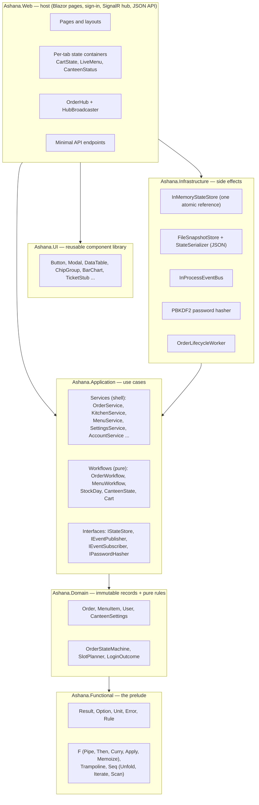
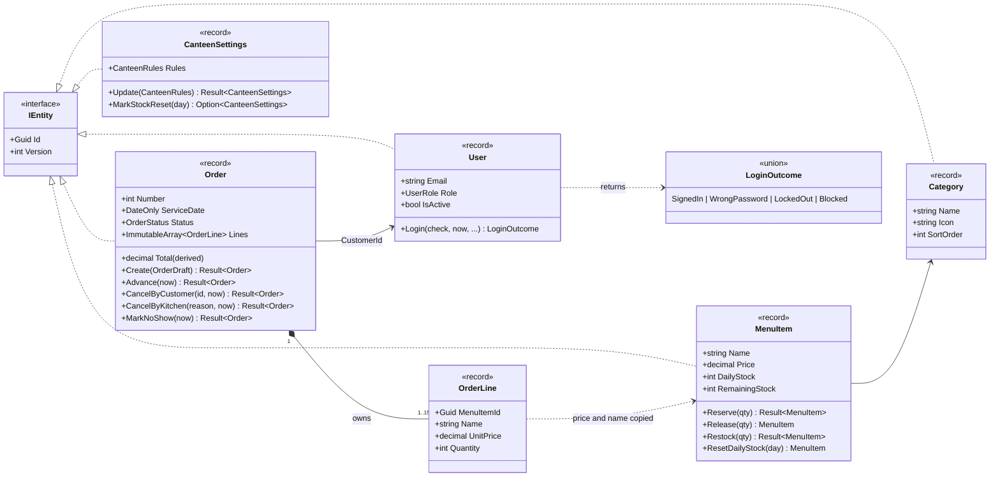
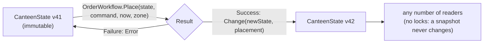
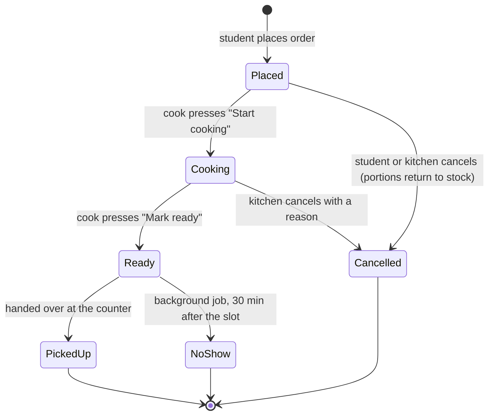
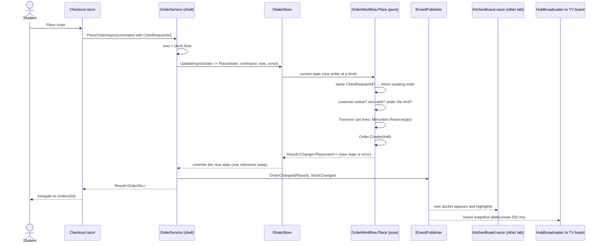
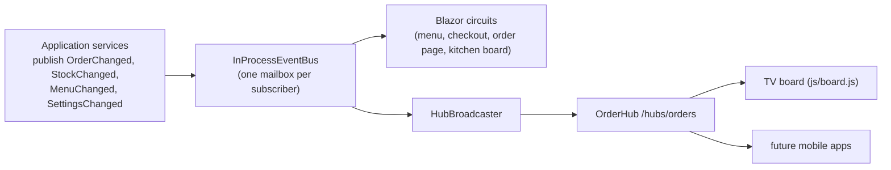

# Architecture

Ashana FP is a Blazor Web App on .NET 10 built as a **functional core inside an imperative shell**,
arranged in Clean Architecture layers: business rules in the middle, frameworks at the edges, every
dependency pointing inwards.

* **Functional core** (`Ashana.Functional`, `Ashana.Domain`, the `*Workflow` classes of `Ashana.Application`):
  immutable records and pure functions. A use case is a function `CanteenState → Result<Change<T>>`:
  it never reads the clock, never saves, never logs. Same input, same output.
* **Imperative shell** (the `*Service` classes, `Ashana.Infrastructure`, `Ashana.Web`): reads the clock,
  runs the pure transition through the state store, then does the side effects (log, publish events, answer HTTP).

See [functional-programming.md](functional-programming.md) for how every topic of the course maps to the code.

## 1. Layers



| Project | Knows about | Does not know about |
|---|---|---|
| `Ashana.Functional` | nothing | anything else in the solution |
| `Ashana.Domain` | Functional | storage, ASP.NET Core, Blazor |
| `Ashana.Application` | Domain, `Microsoft.Extensions.*` abstractions | storage technology, HTTP, Blazor |
| `Ashana.Infrastructure` | Application, Domain | Blazor pages |
| `Ashana.UI` | Blazor only | orders, menus, the rest of the app |
| `Ashana.Web` | everything (composition root in `AshanaApp.cs`) | — |

The rule is enforced by project references: `Ashana.Domain.csproj` references only `Ashana.Functional`,
so the compiler rejects any attempt to use, for example, `HttpContext` in a record.

### SOLID in practice

| Principle | Where to look |
|---|---|
| **S**ingle responsibility | `SlotPlanner` only computes slots; `OrderWorkflow` only decides; `OrderService` only runs the decision and its side effects; `HubBroadcaster` only forwards events to SignalR. |
| **O**pen/closed | A new storage provider is a new `IStateStore` implementation plus one `case` in `Infrastructure/DependencyInjection.cs`. New validation rules are new entries in a rule list (`Order.DraftRules`, `MenuItem.Rules`). |
| **L**iskov substitution | Unit tests run the same services against the same `IStateStore` production uses; the workflows are also tested with no store at all. |
| **I**nterface segregation | `IEventPublisher` and `IEventSubscriber` are separate: services only publish, components only subscribe. |
| **D**ependency inversion | Application defines `IStateStore` and `IPasswordHasher`; Infrastructure implements them. |

## 2. Domain model

Every entity is an **immutable record**: all properties are `private init`, the constructor is private,
and a validating factory (`Create`) is the only way in. "Changing" an entity returns a new record
(or an `Error`), with `Version` increased by one.



* **Illegal states are hard to build.** Setters are `private init`, so code outside a record can neither mutate it
  nor create a modified copy with `with`. A cancelled order cannot become "Ready": the only way to move it is a method
  that consults the state machine.
* **Snapshots.** An order line copies the dish name and price, so a later price change does not rewrite history.
* **Result instead of exceptions.** Expected failures ("sold out", "slot full") are `Result<T>` values. The web layer
  maps an `Error.Kind` to an HTTP status (`ApiEndpoints.ToProblem`).
* **Rules as data.** Validation rules are lists of `Rule<T>(predicate, error)` checked in order (`Validation.Check`).

### The state: one immutable value



`CanteenState` holds immutable dictionaries of users, categories, dishes and orders plus the settings.
Immutable collections are balanced trees that **share structure**: a state "with one more order" reuses everything
else, so a change costs O(log n), not a full copy. `InMemoryStateStore` keeps the current state in one reference:
writers run their pure transition one at a time and publish the result with a single atomic write; readers take a
snapshot without waiting. A transition that returns an error (or throws) simply leaves the old state in place,
so every operation is all-or-nothing without a rollback.

### Order life cycle



The table of allowed moves lives in one place: `Domain/Orders/OrderStateMachine.cs`.

### Pickup slots and the service day

`SlotPlanner` cuts opening hours into slots (15 minutes by default) and checks a booking:

1. the canteen accepts orders (the kitchen can pause them);
2. the slot belongs to the **service day** (today until closing time, then tomorrow);
3. the slot starts at least `MinLeadMinutes` from now (time to cook);
4. fewer than `MaxOrdersPerSlot` orders are booked in it.

Limiting orders per slot is the core idea of the project: instead of 300 students arriving at 12:00,
the busiest slots fill up and students choose 12:15 or 12:30. The slot picker shows the load of every slot.

## 3. Placing an order (sequence)



The pure part is one LINQ query over `Result` (railway-oriented programming):

```csharp
from customer in fresh.FindUser(command.CustomerId).ToResult(UserErrors.NotFound)
from active   in Result.Require(customer.IsActive, OrderErrors.UserInactive)
from slot     in SlotPlanner.ValidateBooking(command.SlotStart, now, rules, zone, fresh.CountBookedInSlot)
from limit    in Result.Require(fresh.CountActiveFor(customer.Id) < rules.MaxActiveOrdersPerUser, ...)
from reserved in command.Items.Traverse(line => Reserve(fresh, line))
from order    in Order.Create(new OrderDraft(...))
select Change.Of(fresh.WithAll(reservedItems).With(order), new Placement(order, IsNew: true, reservedItems));
```

* **No overselling.** Transitions run one at a time on the latest state, so checking stock and reserving it can
  never interleave with another order. Twelve parallel students for three portions always give exactly three orders
  (covered by a concurrency test).
* **All or nothing.** If the third cart line fails, the first two reservations exist only in a state value
  that is thrown away.
* **Idempotency.** The checkout page sends a `ClientRequestId`; a double click or a retry returns the same order
  and the same state.
* **Optimistic concurrency.** Every entity has a `Version`. An admin edit based on an old version fails with
  "Someone else changed this dish": it is just one more `Ensure` in the pipeline.

## 4. Real-time updates

There are two real-time paths, both fed by the same application events:



1. **Blazor circuits.** Interactive pages already run over Blazor Server's SignalR connection. A page subscribes
   to `IEventSubscriber`, updates its state and calls `StateHasChanged` through `InvokeAsync`. Subscriptions are
   disposed in `Dispose`, so a closed tab leaves nothing behind.
2. **A public SignalR hub** (`/hubs/orders`, strongly typed `Hub<IOrderHubClient>`) for clients outside Blazor:
   the TV at the counter is a static page with 80 lines of plain JavaScript that reconnects forever.

The event bus gives every subscriber its own bounded `Channel<T>`: a slow or broken browser tab can never
block the others or the service that published the event.

## 5. State management

| State | Where it lives | Why |
|---|---|---|
| Canteen data | `CanteenState`, an immutable snapshot in `IStateStore` (singleton) | readers never lock; every change is a pure transition committed atomically |
| Cart | an immutable `Cart` value held by `CartState` (scoped = one per browser tab) + `ProtectedLocalStorage` | operations return a new cart; survives reloads; encrypted and signed, so the browser cannot tamper with it |
| Live menu and stock | `LiveMenu` (scoped) subscribed to stock and menu events | one subscription per tab instead of one per component |
| Orders paused banner | `CanteenStatus` (scoped) | the banner appears for everyone the moment the kitchen presses pause |
| Signed-in user | `CurrentUserProvider` cascades a `CurrentUser` record | components write `[CascadingParameter] CurrentUser? User` instead of parsing claims |
| Toasts | `ToastService` (scoped, in the UI library) | any component can show a message; `ToastHost` renders them |
| Dashboard data | `[PersistentState]` (new in .NET 10) | data computed during prerendering is reused by the interactive render; no second query |
| Shared clock tick | `Ticker` (scoped) | one 20-second timer per tab keeps "5 min late" labels correct |

## 6. Render modes

| Page | Render mode | Reason |
|---|---|---|
| Menu, checkout, orders, kitchen, admin | Interactive Server, prerendered | instant first paint, then live updates |
| Sign-in, sign-up | Static SSR (`[ExcludeFromInteractiveRouting]`) | only a normal HTTP response can set the auth cookie |
| TV board | Static SSR + plain JavaScript | can stay on all day without holding a Blazor circuit |

## 7. Security

* **Authentication:** cookie with the user id, name and role; `HttpOnly`, `SameSite=Lax`, sliding 7-day expiry.
* **Passwords:** PBKDF2 (HMAC-SHA512, 100,000 iterations, per-user salt) from ASP.NET Core Identity.
  Five wrong passwords lock the account for five minutes; unknown emails take the same time to answer.
* **Role-based access control:** policies `Kitchen` (Cook or Admin) and `Admin`, applied with
  `[Authorize(Policy = ...)]` on pages and `RequireAuthorization` on API endpoints.
* **Revalidation:** open tabs re-check the user every two minutes. A blocked user or a changed role takes
  effect without a reload (`RevalidatingUserStateProvider`).
* **Antiforgery** on every form, including sign-out (a POST, never a link).
* **Rate limiting:** 10 sign-in attempts per minute per IP, 120 API calls per minute per IP.
* **Security headers:** a strict Content-Security-Policy (no inline scripts), `X-Frame-Options: DENY`,
  `nosniff`, `Referrer-Policy`, `Permissions-Policy`.
* **Open-redirect protection:** `returnUrl` must be a local path.
* **CSV injection:** exported cells that start with `=`, `+`, `-` or `@` are neutralized.
* **Privacy:** the TV board shows order numbers only, never names.

## 8. Error handling and resilience

* Expected failures are `Result` values with user-friendly messages; the checkout explains what changed
  ("Price of Plov changed", "Only 2 portions left") and fixes the cart automatically.
* `ErrorBoundary` in the layout: a crash inside one page shows "Try again" instead of killing the whole tab.
* JavaScript interop calls tolerate a disconnected browser (`AshanaJs.IsBrowserGone`).
* The background worker survives a failed run and retries; the event bus isolates failing subscribers.
* A bug that throws inside a transition cannot corrupt data: the store keeps the previous state.
* The file store writes atomically (temporary file + rename) and is debounced; a crash never leaves half a file.
* A custom reconnect dialog appears when the connection drops; the circuit is kept for 3 minutes.
* `/health` reports the state of the data store for monitoring.

## 9. Efficiency

* Prerendering (server-side rendering) for a fast first paint; static SSR where interactivity is not needed.
* `MapStaticAssets`: compressed (gzip/Brotli), fingerprinted static files with long cache lifetimes.
* The menu is a pure projection of the state, memoized with `F.MemoizeLast`: thousands of students get the same
  ready-made `MenuDto` until the state changes, and there is no cache to clear by hand. Anonymous API responses use output caching.
* Lazy evaluation: slots are unfolded lazily (`Seq.Unfold`), analytics queries are lazy LINQ pipelines, the dummy
  password hash is a `Lazy<T>` computed only on the first unknown email.
* Structural sharing: a new state reuses almost all of the previous one, so writes stay cheap as data grows.
* Debouncing: search input (250 ms), kitchen reloads (150 ms), TV snapshots (250 ms), checkout refresh (400 ms),
  slot refresh on the menu (500 ms), file saves (400 ms). A burst of 20 orders causes one re-render, not 20.
* `@key` on every list so Blazor reuses DOM rows; CSS isolation keeps styles small and scoped.
* The JS helper module is imported lazily the first time it is needed.
* Fonts are self-hosted variable WOFF2 files split by `unicode-range`: Latin pages never download Cyrillic glyphs.
* Charts are plain HTML and CSS: no chart library is downloaded.

## 10. Scalability

The current deployment target is one server per canteen, which comfortably serves a university
(the menu is read from memory; writes are small). The design keeps the way open to grow:

| Today (one server) | Next step | What changes in the code |
|---|---|---|
| Immutable state in memory, saved to a JSON file | an event log in PostgreSQL (each transition stored as an event) or EF Core | one new `IStateStore` in Infrastructure |
| `InProcessEventBus` | Redis pub/sub or a message broker | one new `IEventPublisher`/`IEventSubscriber` |
| one writer queue per process | one writer per canteen (shard by canteen) or optimistic retries | inside the `IStateStore` implementation |
| One SignalR server | Azure SignalR Service or a Redis backplane | configuration in `WebServices.cs` |
| One canteen | several canteens | add a `CanteenId` to the aggregates |

The domain and the pure workflows do not change in any of these steps: they only take a state and return a new one.
