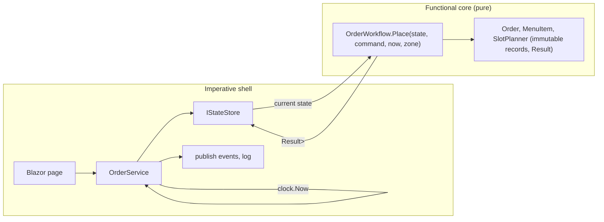

# Functional programming in Ashana FP

This document maps the course **Introduction to Functional Programming (FP 3222)** to the code.
For every idea it gives the file to open and a short explanation, so either team member can show it during the defense.

The design in one sentence: **a functional core inside an imperative shell.** The core (immutable records and pure
functions) makes every decision; the shell (services, store, web pages) only reads the clock, runs the decision and
performs side effects.

## 1. Course learning outcomes

| Learning outcome | Where it is in Ashana FP |
|---|---|
| **Implement functional constructs**: pure functions, recursion, higher-order functions | All `*Workflow` classes are pure (`Application/Orders/OrderWorkflow.cs`, `Application/Menu/MenuService.cs` → `MenuWorkflow`). Recursion: `SlotPlanner.NextFreeSlot` (trampolined). Higher-order: `Map`, `Bind`, `Traverse`, `MenuWorkflow.ChangeItem(state, id, change)` takes the change as a function. |
| **Work with data structures** functionally | `CanteenState` is built from `ImmutableDictionary` (an immutable balanced binary tree with structural sharing); `ImmutableArray<OrderLine>`; `ImmutableList<CartLine>` in `Cart`. Updates return a new structure: `state.With(order)`. |
| **Utilize type systems**: strong static types, type inference, algebraic data types | Records everywhere (product types). Discriminated unions (sum types): `LoginOutcome`, `Trampoline<T>`, `AppEvent`. `Result<T>` and `Option<T>` are generic algebraic types; `var` and generic type inference in every pipeline. |
| **Apply advanced features**: monads, functors, lazy evaluation | `Result<T>` and `Option<T>` are functors (`Map`) and monads (`Bind`, LINQ `SelectMany`); the laws are tested in `tests/Ashana.UnitTests/Functional/ResultAndOptionTests.cs`. Lazy: `Seq.Unfold`, `Seq.Iterate`, `yield return`, `Lazy<T>`, LINQ deferred execution. |
| **Handle errors effectively** with Maybe and Either | `Option<T>` = Maybe, `Result<T>` = Either<Error, T>. No business rule throws; `Result.Try` converts exceptions from outside code into values. |
| **Analyze and optimize** functional code, lazy evaluation for large or infinite data | `F.MemoizeLast` caches the menu per state snapshot; slots are generated lazily (taking 2 computes 2); `Seq.Iterate` produces infinite sequences; `Trampoline` makes 1,000,000-step recursion stack-safe; structural sharing keeps updates O(log n). |

## 2. The functional prelude: `src/Ashana.Functional`

A tiny library with no dependencies, written for this project and used by every other layer.

| File | What it gives | Course topic |
|---|---|---|
| `Unit.cs` | `Unit`, the type with one value: `Result<Unit>` replaces `void` | type systems |
| `Error.cs` | `Error` record (code, message, kind) | errors as values |
| `Result.cs` | `Result<T>`: success or error; `Match`; `Result.Try`, `Require`, `Combine` | Either, exception handling in FP |
| `ResultExtensions.cs` | `Map`, `Bind`, `Ensure`, `MapError`, `OrElse`, `Tap`, `Traverse`, `Sequence`, `FoldResult`, LINQ `Select`/`SelectMany`, async versions | functor, monad, railway-oriented programming, pipelining |
| `Option.cs` | `Option<T>`: `Some` or `None`; `Map`, `Bind`, `Where`, `GetOrElse`, `ToResult`, `FirstOrNone`, `Find`, `Choose`, LINQ | Maybe, handling nulls |
| `Validation.cs` | `Rule<T>(predicate, error)`; `Check` (first broken rule) and `AllErrors` | rules as data |
| `F.cs` | `Pipe`, `Then` (composition), `Compose` (pipeline from a list), `Curry`, `Uncurry`, `Apply` (partial application), `Memoize`, `MemoizeLast`, `Identity` | higher-order functions, currying, composition |
| `Trampoline.cs` | `Trampoline<T>` union (`Done` / `More`) and `Run()` | recursion, trampolining |
| `Seq.cs` | `Unfold`, `Iterate` (infinite), `Scan` (running fold) | lazy evaluation |

## 3. Weekly course plan → code

| Week | Topic in the syllabus | In Ashana FP |
|---|---|---|
| 1 | Properties of FP; refactor imperative code to a functional style | Version 1 of Ashana used mutable entities and a unit of work. This version is the refactoring: compare `Order.StartCooking` (now returns a new `Order`) or `Cart.Add` (now returns a new `Cart`). |
| 2 | Results-oriented programming, enumerables, immutability, pure functions | `Result<T>` in every use case; LINQ over `IEnumerable`; every entity is an immutable record. |
| 3 | Pattern matching, read-only structs, records, immutable models; concurrency | Switch expressions in `Order.Stamp`, `OrderStateMachine.NextKitchenStep`, `UiText`, `SlotService.Classify`; `PickupSlot` and `Unit` are `readonly record struct`; `Option<T>` is a `readonly struct`. Concurrency: immutable snapshots read without locks, one writer at a time (`InMemoryStateStore`). |
| 4 | Custom enumerations, parsing values, LINQ data pipelines | `Seq.Unfold` builds the slot sequence; `AnalyticsService.Compute` and `KitchenService.BuildPrepList` are LINQ pipelines (`GroupBy`, `Sum`, `OrderBy`); `Option.Choose` is a filter-map. |
| 5 | Higher-order functions, handling nulls, isolating side effects, DI | `Option<T>` instead of `null` for every lookup (`state.FindOrder(id)`); side effects only in services; the clock comes in through `TimeProvider`/`CanteenClock`, passed to pure functions as a plain value. |
| 6 | Factories, discriminated unions, composing functions, currying | Validating factories (`Order.Create`, `MenuItem.Create`, `User.Create`); unions `LoginOutcome`, `AppEvent`, `Trampoline<T>`; `F.Then`, `F.Compose` (menu filter pipeline in `MenuFiltering.Apply`); currying in `OrderDto.In(zone)` and `SlotService.BuildDay`. |
| 7 | Wrappers, `Map()` versus `Bind()`, Maybe, Option, Either, `Result<T>` | `ResultExtensions.Map` vs `Bind` (see the XML comments), `Option<T>`, `Result<T>`; exception-heavy code replaced: no `ConcurrencyConflictException` any more, a conflict is an `Error`. |
| 8 | Currying, partial application, records and inheritance for unions, switch expressions | `F.Curry`, `F.Apply`; `LoginOutcome` is a closed record hierarchy matched with `switch` in `AccountService.SignInAsync`. |
| 9 | Organizing exceptions, recursion, trampolining; domain models with types | `Result.Try`; `SlotPlanner.NextFreeSlot` is tail recursion on a `Trampoline`; the domain is modelled with records, enums and unions. |
| 10 | Design, implementation and testing; final project | This project, its tests (`tests/`) and documentation (`docs/`). |

## 4. Assignments → code

| Assignment | Where the same skills appear |
|---|---|
| 1. Controlling flow, converting types, representing functions | Flow is controlled by `Result` pipelines instead of `if`/`throw`; implicit conversions `T → Result<T>`, `Error → Result<T>`, `T → Option<T>`; functions as values (`Func<CanteenState, Result<Change<T>>>` is the type of every use case). |
| 2. Writing, debugging and testing functions | Pure functions are tested with plain values: `WorkflowPurityTests` call `OrderWorkflow.Place` with no services or mocks. |
| 3. Interfaces and programming with a mutable type | `IStateStore` is the interface; `InMemoryStateStore` contains the **only** mutable field of the data path (one reference), isolated and synchronized. `CartState` does the same for one browser tab. |
| 4. Files, streams and serialization | `FileSnapshotStore` writes the state with `System.Text.Json` over a `FileStream` (atomic: temp file + rename); `StateSerializer` reads it back into immutable records with private `init` setters. |
| 5. Composing functions using pipelining | `x.Pipe(f)`, `f.Then(g)`, `F.Compose(steps)`, fluent `Result` pipelines (`.Ensure(...).Bind(...).Map(...)`), LINQ. |
| 6. Handling temporal coupling | Immutable values remove "call A before B" rules: an `Order` is complete the moment `Create` returns, a step returns a new value instead of changing hidden state, and a transition sees one consistent snapshot. The store's single-writer queue removes the "check, then act" race. |
| 7. Exception handling in FP | `Result<T>` and `Error`; `Result.Try`; the store keeps the old state if a transition throws; the web layer maps `Error.Kind` to HTTP status codes. |
| 8. Extension methods and LINQ | The whole prelude is extension methods; LINQ query syntax works over `Result` and `Option` because they implement `Select` and `SelectMany`. |

## 5. Five things to show in the code

1. **A use case is a pure function.** Open `Application/Orders/OrderWorkflow.cs`, method `PlaceNew`: one LINQ query,
   each `from` can fail, the first failure becomes the answer. It receives `now` and `zone` as arguments.
2. **Immutability.** Open `Domain/Orders/Order.cs`: `private init` setters, `MoveTo` returns
   `Stamp(target, now) with { Status = target, Version = Version + 1 }`. The old order is unchanged
   (test `Kitchen_steps_return_new_orders_and_record_when_each_step_happened`).
3. **The only mutation.** Open `Infrastructure/Persistence/InMemoryStateStore.cs`: one field, one writer at a time,
   one `Volatile.Write`. Readers never lock.
4. **Unions and pattern matching.** `Domain/Users/User.cs` (`LoginOutcome`) and `Application/Users/AccountService.cs`
   (`switch` over its cases).
5. **Laws and laziness.** `tests/Ashana.UnitTests/Functional`: monad laws, a million-step trampoline,
   infinite sequences that only compute what is taken.

## 6. Where we chose not to be pure, and why

* **Blazor components** keep local UI state in fields (the framework's model). They only hold *current values*
  of immutable data (`CartState` holds a `Cart` value).
* **Logging, events, the clock and password hashing** are side effects by nature. They live in the shell, so the
  core stays testable.
* **The demo data seeder** uses `System.Random` with a fixed seed; the result is still deterministic
  (test `Building_the_demo_state_is_deterministic_for_a_seed`).
