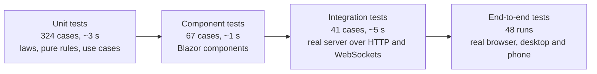

# Testing and quality assurance

Ashana FP is tested at four levels. Each level catches a different kind of mistake, and the lower levels are fast
enough to run on every change.



## How to run

```bash
dotnet test                                   # all .NET tests (unit, component, integration)
dotnet test tests/Ashana.UnitTests            # one project
dotnet test --filter "FullyQualifiedName~OrderService"   # one area
dotnet test --collect:"XPlat Code Coverage"   # with coverage (coverlet), see below
```

End-to-end tests need Node.js 20 or newer:

```bash
cd tests/e2e
npm install
npx playwright install chromium               # once: downloads the browser
npm test                                      # starts the app itself (in-memory data) and runs every spec
npm run test:headed                           # watch it click through the app
BASE_URL=http://localhost:5191 npm test       # test an app you already started
```

## What each level covers

### Unit tests: `tests/Ashana.UnitTests`

Two kinds of unit tests. **Pure tests** call the functional core directly with plain values: no services, no
store, no mocks (`Functional/*`, `Domain/*`, `Application/WorkflowPurityTests.cs`). **Service tests** run the real
application services against the real `InMemoryStateStore`, with a controllable clock
([`ManualTimeProvider`](../tests/Ashana.UnitTests/Support/ManualTimeProvider.cs)), so a test can jump to "after
closing time" or "tomorrow" without waiting. Events are recorded instead of sent, so they can be checked synchronously.

| Area | Examples of what is proved |
|---|---|
| Functional prelude | functor and monad laws for `Result` and `Option`; short-circuiting; LINQ query syntax; `Traverse` stops at the first error; currying, partial application, composition, memoization; a 1,000,000-step trampoline; lazy and infinite sequences; rules as data |
| Purity of the use cases | placing an order returns a new state and leaves the input state untouched; same input → same decision; idempotency returns the very same state; an order's life is a fold of transitions |
| Order state machine | every allowed and every forbidden status change; final states have no way out |
| Order record | totals, price snapshots, cancel rules, late and no-show detection, versioning; every step returns a new order and the original stays unchanged |
| Menu item | reservation returns a new dish, never negative, refilled once per day; all broken field rules can be listed |
| Slot planner | lazy slot generation, service day after closing, lead time, full slots suggest the next free one (trampolined recursion over 200,000 slots), any time-zone offset |
| Placing an order | idempotency (double click = one order), price changed, sold out, slot full, paused, active-order limit |
| Concurrency | 12 students order the last 3 portions at the same moment: exactly 3 orders succeed, stock ends at 0 |
| Kitchen | two cooks pressing the same button cannot skip a step; prep list totals |
| Admin | two admins editing the same dish; the settings form cannot undo the kitchen's pause; last admin protection |
| Accounts | lockout after 5 wrong passwords (a fold over failed sign-ins), every `LoginOutcome` case, same answer for unknown email and wrong password |
| Analytics | revenue counts picked-up orders only, rates, CSV escaping against formula injection |
| Infrastructure | snapshots never change, a failed or throwing transition keeps the old state, 40 parallel updates lose nothing, JSON round trip of immutable records, file store, event bus isolation, background worker, deterministic demo data |

### Component tests: `tests/Ashana.ComponentTests`

Components are rendered in memory without a browser:

* markup is checked with Blazor's built-in `HtmlRenderer` (exactly what server-side rendering produces);
* interaction is checked with [`TestRenderer`](../tests/Ashana.ComponentTests/Support/TestRenderer.cs), a
  small test renderer that walks Blazor's render tree, finds elements and dispatches clicks to their event
  handlers, the way bUnit does internally.

Covered: buttons (variants, busy state, disabled clicks), quantity stepper, chip group, data table (sorting,
paging, empty state), charts, icons, avatar, load bar, status steps, ticket, toasts, the slot picker, menu rows,
kitchen dockets and the status texts students see.

### Integration tests: `tests/Ashana.IntegrationTests`

The real app (same `AshanaApp.BuildAsync` as `Program.cs`) starts on a random local port with in-memory demo data.
Tests use plain `HttpClient` with a cookie jar ([`TestBrowser`](../tests/Ashana.IntegrationTests/Support/TestBrowser.cs))
and a raw WebSocket SignalR client ([`HubClient`](../tests/Ashana.IntegrationTests/Support/HubClient.cs)).

Covered: sign-in through the real form with antiforgery tokens, return URLs and open-redirect protection, demo
sign-in, registration and its validation, role-based access to pages and API, CSV export, sign-out protection,
rate limiting (429), security headers, friendly 404 for people and plain status codes for API clients, the public
API, and the SignalR hub delivering live board updates.

### End-to-end tests: `tests/e2e`

Playwright drives Chromium on a desktop screen and on a phone (Pixel 7 profile).

| Spec | What it checks |
|---|---|
| `smoke.spec.ts` | first visit, sign-in for every role, access rules, wrong password, live TV board, PWA offline page |
| `layout.spec.ts` | 16 pages fit the screen without sideways scrolling; navigation moves to the bottom on phones |
| `accessibility.spec.ts` | axe-core audit (WCAG 2.1 A and AA) of 16 pages, plus the dark theme |
| `ordering.spec.ts` | the full story with three browsers at once: student orders, cook cooks, TV shows the number, all live; cancelling; pausing orders; cart kept after reload |

Tests that need Blazor's interactivity are tagged `@interactive`.

## Results of the latest run

| Suite | Result |
|---|---|
| Unit | 324 of 324 passed |
| Component | 67 of 67 passed |
| Integration | 41 of 41 passed |
| End-to-end, server-rendered and live TV (`--grep-invert @interactive`) | 42 of 42 passed (desktop and phone) |
| End-to-end, interactive (`--grep @interactive`) | 6 runs; run them with `npm test` on a machine with the full .NET SDK |

The build machine used for this run had no access to nuget.org, so the .NET suites ran on a minimal xUnit-compatible
runner and the interactive browser tests could not load Blazor's script. Run `dotnet test` and `npm test` on your
own machine to confirm the counts with the real xUnit runner.

## Bugs the tests and QA found

Every bug below was real (found while building version 1, before the functional rewrite), was fixed, and is still
covered by a test in this version, so it cannot come back. The rewrite itself was checked by the same behaviour tests,
rewritten from "the object changed" to "the function returned a new value".

| Found by | Problem | Fix |
|---|---|---|
| Unit test `CanteenClockTests` | On a server without time-zone data the app crashed at startup: the fallback zone name used an invalid `TimeSpan` format. | Build the name explicitly (`UTC+05:00`). |
| Integration test `Pages_carry_security_headers` | Interactive pages got Blazor's own `frame-ancestors 'self'` header, and our middleware then skipped the full Content-Security-Policy. | Turn off Blazor's header and always send the full, stricter policy. |
| Manual QA with `curl` | Unknown URLs returned an empty 404: re-executing the error page inside `UseWhen` lost the router. | Re-execute in the main pipeline and switch it off for `/api`, `/hubs`, `/health`. |
| Visual QA (screenshots) | TV numbers lost their style after the first live update: elements created by JavaScript carry no CSS-isolation attribute. | Style them through `::deep`. |
| Code review, then unit test | An admin saving the settings form could silently undo the kitchen's "pause orders". | Optimistic concurrency on settings (version check). |
| axe-core audit | The account link's name did not contain its visible text; "Order again" labels split the visible words; a chip counter had 4.4:1 contrast; error pages had no `h1`. | Fixed labels, colors and headings. |

## Code coverage

Every test project references `coverlet.collector`:

```bash
dotnet test --collect:"XPlat Code Coverage" --results-directory TestResults
dotnet tool install -g dotnet-reportgenerator-globaltool
reportgenerator -reports:"TestResults/**/coverage.cobertura.xml" -targetdir:coverage -reporttypes:"Html;TextSummary"
cat coverage/Summary.txt
```

## Manual QA checklist

Automated tests cannot judge everything. Before a release (and before the defense) go through this list on a real
phone and a laptop:

- [ ] Order on a phone with one hand: add dishes, change quantities, choose a slot, place the order.
- [ ] Kitchen board on a tablet in landscape: buttons are easy to hit, the chime plays after **Sound off → Sound on**.
- [ ] TV board on a big screen from three metres away: ready numbers are readable.
- [ ] Turn Wi-Fi off and on with the order page open: the reconnect dialog appears and disappears, the status catches up.
- [ ] Safari on iPhone: add to home screen, the app opens full-screen with the right icon.
- [ ] Dark theme: every page is readable, the ticket and charts look right.
- [ ] Keyboard only: Tab through the menu, open and close a dialog with Esc, place an order.
- [ ] Screen reader (VoiceOver: Cmd+F5 on macOS): the order status change is announced.
